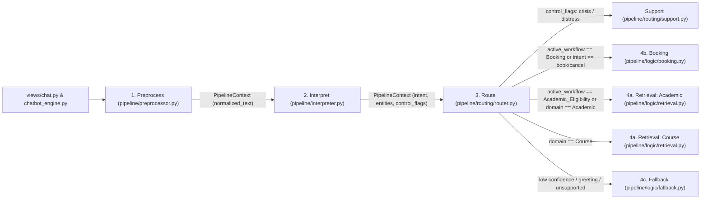

# NLP Pipeline Migration & Consolidation Plan (`MAIN` / `NPL-OVERHAUL2`)

> [!IMPORTANT]
> This plan is grounded strictly against the current file structure of `MAIN` and `NPL-OVERHAUL2`. It consolidates NLU, routing, domain logic, and static data under `pipeline/`, reconciles interface signatures across all stages, and removes obsolete top-level directories (`nlu/`, `dialogue/`, `references/`, `responses/`).

---

## 1. Target Pipeline Architecture



---

## 2. Migration & File Consolidation Matrix

This mapping transitions the current `MAIN` / `NPL-OVERHAUL2` workspace into a flat, behavior-driven pipeline while eliminating redundant wrapper packages.

| Current Path(s) on `MAIN` / `NPL-OVERHAUL2` | Target Path | Action & Architectural Rationale |
| --- | --- | --- |
| *(New)* + `_curriculum_context` in `chatbot_engine.py` | `pipeline/context.py` | **Create & Elevate:** Define `PipelineContext` (`@dataclass`) at the root of `pipeline/` so NLU, Routing, and Logic layers can import it without circular dependencies. Replaces process-global `_curriculum_context` with per-chat `session_state`. |
| `nlu/course_lookup.py` & `pipeline/curriculum_engine.py` | `pipeline/logic/data/courses.py` | **Consolidate & Relocate:** Merge survey `COURSE_INDEX` (`course_scores.json`, `course_sentiments.json`) and `CurriculumEngine` (`curriculum_data.json`) into one unified course data module under `pipeline/logic/data/`. |
| `nlu/entity_extractor.py` | `pipeline/logic/data/course_aliases.py` | **Relocate & Standardize:** Decouple static course code/name alias generation from NLU extraction. Export immutable mappings (`COURSE_ALIAS_MAP: dict[str, str]`, `NORMALIZED_ALIAS_MAP: dict[str, str]`) with clean syntax and type annotations. |
| `pipeline/academic_entities.json`, `pipeline/binding_rules.json`, `references/HandbookRules.csv`, `responses/intent_responses.json`, `responses/intent_to_rule_map.json`, & `responses/fallback_regex_pairs.json` | `pipeline/logic/data/*` | **Relocate Static Assets:** Centralize all domain dictionaries, rule mappings, and CSV/JSON stores under `pipeline/logic/data/` so top-level `references/` and `responses/` can be deleted. |
| `pipeline/preprocessor.py` | `pipeline/preprocessor.py` | **Refactor In-Place:** Replace NLTK network downloads and digit-stripping with resource-independent regex tokenization and alias resolution via `COURSE_ALIAS_MAP`. |
| `pipeline/featureExtraction.py`, `pipeline/intent_classifier.py`, & `nlu/intent_classifier.py` | `pipeline/interpreter.py` | **Consolidate & Elevate:** Unify course survey intent patterns, academic n-gram/bound-entity extraction, handbook rule mapping, and booking/cancel intent detection into `interpret(ctx: PipelineContext) -> PipelineContext`. |
| Distress branches in `chatbot_engine.py` | `pipeline/routing/support.py` | **Extract:** Isolate `CRISIS_TERM` and `ACADEMIC_DISTRESS` detection and responses into an upstream support module. |
| Dispatch logic in `chatbot_engine.py` & `views/chat.py` | `pipeline/routing/router.py` | **Centralize Dispatcher:** Keep strictly for branch dispatching (Support/Control & active workflow locks vs. Domain Registry). |
| `dialogue/response_generator.py`, `dialogue/response_templates.py`, `references/csv_parser.py`, & course/academic handlers in `chatbot_engine.py` | `pipeline/logic/retrieval.py` | **Consolidate:** Collapse course survey NLG, curriculum prerequisites/eligibility, and handbook CSV lookup into a single parameterized retrieval module. |
| Booking/cancel NLU & slot parsing in `state.py` & `views/chat.py` | `pipeline/logic/booking.py` | **Extract & Flatten:** Convert one-shot UI booking interception into a stateful multi-turn slot-filling module (`advisor`, `date`, `time`, `modality`, `place`). |
| Greeting & NLTK Chat fallback in `chatbot_engine.py` | `pipeline/logic/fallback.py` | **Extract & Flatten:** Consolidate deterministic greeting/thanks mappings, `fallback_regex_pairs.json` matching, and default out-of-scope guidance. |
| `nlu/`, `dialogue/`, `references/`, `responses/`, & legacy `pipeline/*.py` | *Delete* | **Clean Up Obsolete Folders:** Remove all four obsolete top-level directories and legacy `pipeline/` files once tests pass. |

---

## 3. Target Workspace Tree & Obsolete Folder Cleanup

### Target Structure
```text
Archi/
├── app.py
├── chatbot_engine.py                 # Thin adapter delegating to NLPPipeline
├── state.py                          # Streamlit UI/session state & advisor/calendar UI helpers
├── styles.py
├── components/                       # Streamlit UI modals & email mockup
├── data/                             # Raw survey & curriculum JSON datasets
├── images/                           # UI icons
├── static/                           # Fonts
├── views/                            # Streamlit pages (chat.py wired to NLPPipeline)
└── pipeline/
    ├── __init__.py                   # Exports NLPPipeline, preprocess, interpret, Router
    ├── context.py                    # PipelineContext dataclass & session state helpers
    ├── preprocessor.py               # Tokenization, normalization, & course alias resolution
    ├── interpreter.py                # Unified intent & entity extraction
    ├── routing/
    │   ├── __init__.py
    │   ├── router.py                 # Upstream control/support checks, workflow lock, & domain registry
    │   └── support.py                # Crisis & academic distress detection/responses
    └── logic/
        ├── __init__.py
        ├── retrieval.py              # Parameterized Course & Academic retrieval + eligibility flow
        ├── booking.py                # Stateful multi-turn consultation booking & cancellation
        ├── fallback.py               # Deterministic greetings & regex fallback
        └── data/
            ├── __init__.py
            ├── courses.py            # Merged COURSE_INDEX & CurriculumEngine
            ├── course_aliases.py     # Immutable COURSE_ALIAS_MAP & canonical resolution
            ├── HandbookRules.csv
            ├── academic_entities.json
            ├── binding_rules.json
            ├── fallback_regex_pairs.json
            ├── intent_responses.json
            └── intent_to_rule_map.json
```

### Obsolete Directories & Files to Delete
* **Top-level directories to delete completely:**
  * `nlu/` (`course_lookup.py`, `entity_extractor.py`, `intent_classifier.py`)
  * `dialogue/` (`response_generator.py`, `response_templates.py`)
  * `references/` (`csv_parser.py`, `HandbookRules.csv`)
  * `responses/` (`fallback_regex_pairs.json`, `intent_responses.json`, `intent_to_rule_map.json`)
* **Legacy files inside `pipeline/` to delete:**
  * `pipeline/featureExtraction.py`
  * `pipeline/intent_classifier.py`
  * `pipeline/curriculum_engine.py`
  * `pipeline/academic_entities.json` (moved to `pipeline/logic/data/`)
  * `pipeline/binding_rules.json` (moved to `pipeline/logic/data/`)

---

## 4. Phase-by-Phase Execution Plan

### Phase 1: State & Data Layer Centralization
1. **Unify Context (`pipeline/context.py`):**
   * Define `PipelineContext` using `@dataclass` to hold:
     * `raw_text: str`
     * `normalized_text: str = ""`
     * `intent: str | None = None`
     * `confidence: float = 0.0`
     * `entities: dict[str, Any] = field(default_factory=dict)`
     * `control_flags: dict[str, Any] = field(default_factory=dict)`
     * `session_state: dict[str, Any] = field(default_factory=dict)`
   * Provide `ensure_session_state(session: dict | None) -> dict` to initialize `active_workflow`, `pending_slot`, `slots`, and `completed_booking`.
2. **Isolate Static Data (`pipeline/logic/data/`):**
   * Relocate `HandbookRules.csv`, `academic_entities.json`, `binding_rules.json`, `fallback_regex_pairs.json`, `intent_responses.json`, and `intent_to_rule_map.json` into `pipeline/logic/data/`.
   * Create `pipeline/logic/data/courses.py` merging `CurriculumEngine` and `COURSE_INDEX`.
   * Create `pipeline/logic/data/course_aliases.py` exporting `COURSE_ALIAS_MAP: dict[str, str]` (including prefix-stripped shorthand like `"prog1"`, `"dsalg"`, spaced codes like `"cbemc 1"`, and full course names) with clean type hints and zero linter/syntax issues.

### Phase 2: NLU Ingestion Separation
1. **Refactor `pipeline/preprocessor.py`:**
   * Update imports to pull `COURSE_ALIAS_MAP` from `pipeline.logic.data.course_aliases`.
   * Implement `preprocess(raw_input: str, session: dict | None = None) -> PipelineContext`:
     * Instantiate `PipelineContext(raw_text=raw_input, session_state=ensure_session_state(session))`.
     * Resolve course aliases in `raw_input` and populate `ctx.normalized_text` while preserving digits (terms `1`–`3`, dates, times, course numbers) and negation tokens.
2. **Create `pipeline/interpreter.py`:**
   * Consume `ctx.normalized_text`, run classification and entity extraction, and write outputs directly to `ctx.intent`, `ctx.confidence`, `ctx.entities`, and `ctx.control_flags`:
     * **Upstream Flags (`ctx.control_flags`):** `crisis`, `academic_distress`, `cancel_flow`.
     * **Entities (`ctx.entities`):** `course_codes`, `target`, `rule_id`, `action`, `advisor`, `date`, `time`, `modality`, `place`, `topic`, `notes`, `booking_errors`, `booking_notes`.
     * **Intents (`ctx.intent`):**
       * *Booking:* `book_consultation`, `cancel_consultation`
       * *Course:* `difficulty`, `workload`, `tips`, `sentiment`, `overview`
       * *Academic:* `prerequisites`, `eligibility`, `handbook`, `offerings`, `FLOWCHART_UPDATE`, `ACTION_DEFER`, `ACTION_FAIL`, `ACTION_ADVISE`, `CONSULTATION_TERM`, `ACTION_SCHEDULE`, `ACTION_RESCHEDULE`, `ACTION_CANCEL`, `GPA_CALCULATE`, `GPA_UNDERSTAND`, `GPA_LOW_CONCERN`, `GPA_IMPROVE`, `STATUS_CHECK`
       * *Fallback:* `greeting`, `thanks`, `out_of_scope`

### Phase 3: Behavioral Logic Consolidation
1. **Build Unified Retrieval (`pipeline/logic/retrieval.py`):**
   * Implement `query_domain(ctx: PipelineContext, source: Literal["course", "academic"]) -> str` and alias `execute_retrieval = query_domain`.
   * **`source == "course"`:** Lookup `COURSE_INDEX` using survey templates (`difficulty`, `workload`, `tips`, `sentiment`, `overview`), falling back to `CURRICULUM.describe_course(code)` if no survey entry exists, or prompting for a course code when omitted.
   * **`source == "academic"`:**
     * *Stateless queries:* `prerequisites` (hard, soft, corequisites from `CURRICULUM`), `handbook` (section title, rule text, and sub-rules from `HandbookRules.csv`), `offerings`, and template-mapped intents from `intent_responses.json`.
     * *Multi-turn `eligibility`:* Store `target_course` and `passed_courses` in `ctx.session_state["slots"]`, lock `ctx.session_state["active_workflow"] = "Academic_Eligibility"`, collect `passed_courses` -> `current_term`, run `CURRICULUM.check_eligibility()`, and clear `active_workflow` on completion.
2. **Build Stateful Booking (`pipeline/logic/booking.py`):**
   * Implement `process_booking(ctx: PipelineContext, booking_service=None) -> str` and alias `handle_booking = process_booking`.
   * Handle `cancel_consultation` by clearing active booking drafts/slots and returning a confirmation message.
   * Check `ctx.session_state["slots"]` for existing booking slot data, merge newly extracted `ctx.entities` (`advisor`, `date`, `time`, `modality`, `place`, `topic`, `notes`), and validate required consultation fields.
   * If validation errors exist or any required slot (`advisor`, `date`, `time`, `modality`, `place`) is missing, set `ctx.session_state["active_workflow"] = "Booking"` and prompt the user for the missing/invalid details.
   * Once all required slots are valid, clear `ctx.session_state["active_workflow"]`, write the finalized draft dict to `ctx.session_state["completed_booking"]` (and invoke `booking_service` if supplied), clear `slots`, and return the confirmation message.
3. **Build Fallback (`pipeline/logic/fallback.py`):**
   * Implement `resolve_fallback(ctx: PipelineContext) -> str` and alias `handle_fallback = resolve_fallback`.
   * Use a deterministic dictionary/list mapping for `greeting` and `thanks`, fall back to `fallback_regex_pairs.json` via `nltk.chat.util.Chat`, and return `FALLBACK_RESPONSE` for low-confidence/out-of-scope inputs.

### Phase 4: Dispatcher, Frontend Wiring & Cleanup
1. **Configure Upstream Branches (`pipeline/routing/router.py` & `pipeline/routing/support.py`):**
   * Evaluate `Support` (`crisis`, `academic_distress`) and `Control` (`cancel_flow`) triggers first in `Router.dispatch(ctx)`. When triggered, clear any active workflow in `ctx.session_state` and return the `support.py` or cancellation response.
   * Check active workflow locks before evaluating general intents:
     * `ctx.session_state.get("active_workflow") == "Booking"` -> `self.registry["Booking"](ctx)`
     * `ctx.session_state.get("active_workflow") == "Academic_Eligibility"` -> `self.registry["Academic"](ctx)`
   * Map `"Course"`, `"Academic"`, `"Booking"`, and `"Fallback"` to their respective callables in `pipeline/logic/` via `self.registry`.
2. **Wire Orchestration & Streamlit UI (`pipeline/__init__.py`, `chatbot_engine.py`, `views/chat.py`):**
   * Expose `NLPPipeline` in `pipeline/__init__.py`.
   * Refactor `chatbot_engine.py` into a clean facade over `NLPPipeline` while preserving `get_response(user_input: str, session_state: dict | None = None) -> str`.
   * Update `views/chat.py` to pass per-chat `current_chat.setdefault("session_state", {})` into the pipeline and redirect to `book_consultation` when `current_chat["session_state"].pop("completed_booking", None)` is present.
3. **Delete Legacy Directories & Files:**
   * Delete `nlu/`, `dialogue/`, `references/`, `responses/`, and obsolete modules in `pipeline/`.

---

## 5. Core Interface Contracts

| Pipeline Stage | Module | Canonical Signature (with Alias) | Output / State Mutation |
| --- | --- | --- | --- |
| **1. Preprocess** | `pipeline/preprocessor.py` | `preprocess(raw_input: str, session: dict) -> PipelineContext` | Instantiates `PipelineContext`, resolves course aliases via `COURSE_ALIAS_MAP`, sets `normalized_text`. |
| **2. Interpret** | `pipeline/interpreter.py` | `interpret(ctx: PipelineContext) -> PipelineContext` | Populates `ctx.intent`, `ctx.confidence`, `ctx.entities`, and `ctx.control_flags`. |
| **3. Route** | `pipeline/routing/router.py` | `Router.dispatch(ctx: PipelineContext) -> str` (alias `dispatch(ctx)`) | Evaluates `support.py` & control branches first, checks `active_workflow` lock, or invokes registered `logic/` callable. |
| **4a. Retrieval** | `pipeline/logic/retrieval.py` | `query_domain(ctx: PipelineContext, source: str) -> str` (alias `execute_retrieval`) | Reads `courses.py` or `HandbookRules.csv`; manages multi-turn `Academic_Eligibility` slots in `ctx.session_state`. |
| **4b. Workflow** | `pipeline/logic/booking.py` | `process_booking(ctx: PipelineContext, booking_service=None) -> str` (alias `handle_booking`) | Mutates `ctx.session_state["slots"]`; locks `"Booking"` workflow until all slots validate, then emits `completed_booking`. |
| **4c. Fallback** | `pipeline/logic/fallback.py` | `resolve_fallback(ctx: PipelineContext) -> str` (alias `handle_fallback`) | Stateless lookup returning greeting, regex-pair match, or unsupported input guidance. |

---

## 6. End-to-End Orchestration (`pipeline/__init__.py`)

```python
from pipeline.context import PipelineContext
from pipeline.preprocessor import preprocess
from pipeline.interpreter import interpret
from pipeline.routing.router import Router


class NLPPipeline:
    def __init__(self, db_client=None, booking_service=None):
        self.router = Router(db_client, booking_service)

    def process_turn(self, user_input: str, session_state: dict | None = None) -> str:
        # Step 1: Normalize & resolve aliases
        ctx = preprocess(user_input, session_state if session_state is not None else {})

        # Step 2: Extract intents & entities
        ctx = interpret(ctx)

        # Step 3: Route to Support/Control or Domain Logic Registry
        return self.router.dispatch(ctx)
```

---

## 7. Verification Checklist

1. **Obsolete Directory Audit:** Confirm `nlu/`, `dialogue/`, `references/`, and `responses/` are deleted and `git grep` shows zero remaining imports referencing them.
2. **Import Graph Audit:** Run `python -m py_compile` across all modules in `pipeline/`, `chatbot_engine.py`, `state.py`, and `views/` to confirm zero syntax errors or circular imports.
3. **Alias Resolution Check:** Verify `COURSE_ALIAS_MAP` in `pipeline/logic/data/course_aliases.py` resolves shorthand and spaced variants (e.g., `"prog1"` -> `"CC/CBPROG1"`, `"dsalg"` -> `"CBDSALG"`, `"cbemc 1"` -> `"CBEMC-1"`) in `preprocess()` prior to `interpret()`.
4. **Multi-Turn Lock Test:**
   * Simulate a partial `Booking` request (e.g., `"Book a consultation with Mr. Morales tomorrow"`), follow up with `"2:00 PM online on Google Meet"`, and verify `router.py` routes to `pipeline/logic/booking.py` instead of dropping into `pipeline/logic/fallback.py`.
   * Simulate an `Academic_Eligibility` request (`"Am I eligible for CBOPESY?"`), follow up with `"CBPROG1, CBPROG2"` and `"Term 2"`, and verify `router.py` keeps the conversation in `pipeline/logic/retrieval.py` (`"academic"`).
5. **Domain Parity Test:** Run sample `Course` and `Academic` queries through `pipeline/logic/retrieval.py` to confirm accurate filtering and formatting across both collections without state leakage.
